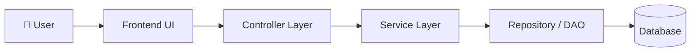
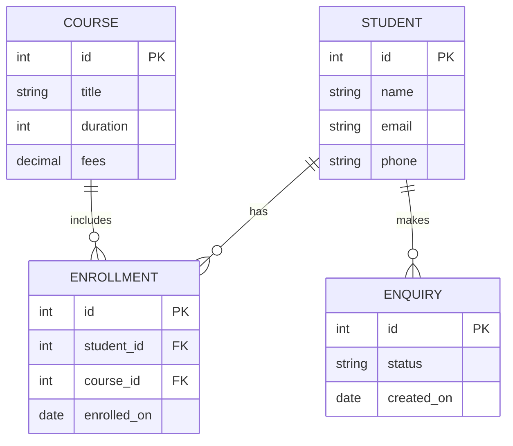

<div align="center">

# 🎓 Education CRM

**A CRM to manage students, courses, enquiries and follow-ups for educational institutions.**


[🚀 Live Demo](#) · [📸 Screenshots](#-screenshots) · [🐛 Report Bug](https://github.com/atharvaughade/education-crm-project/issues) · [✨ Request Feature](https://github.com/atharvaughade/education-crm-project/issues)

</div>

---

## 📑 Table of Contents

- [About](#-about-the-project)
- [Features](#-features)
- [Tech Stack](#-tech-stack)
- [Architecture](#-architecture)
- [Getting Started](#-getting-started)
- [Usage](#-usage)
- [API Endpoints](#-api-endpoints)
- [Project Structure](#-project-structure)
- [Screenshots](#-screenshots)
- [Roadmap](#-roadmap)
- [Contributing](#-contributing)
- [Author](#-author)

---

## 📖 About the Project

[2–3 sentences: What problem does this solve? Who uses it (admins, counsellors, students)? Why did you build it?]

<details>
<summary><b>💡 Problem Statement</b> (click to expand)</summary>
<br>

[Describe the real-world problem, e.g. institutions tracking admissions and enquiries manually in spreadsheets.]

</details>

<details>
<summary><b>🎯 Objectives</b> (click to expand)</summary>
<br>

- [Objective 1]
- [Objective 2]
- [Objective 3]

</details>

---

## ✨ Features

<details open>
<summary><b>👨‍🎓 Student Management</b></summary>
<br>

- [x] [Add / edit / delete student records]
- [x] [Search and filter students]
- [ ] [Another feature]

</details>

<details>
<summary><b>📚 Course Management</b></summary>
<br>

- [x] [Create and manage courses]
- [ ] [Batch / schedule handling]

</details>

<details>
<summary><b>📞 Enquiry & Lead Tracking</b></summary>
<br>

- [x] [Capture enquiries]
- [ ] [Follow-up reminders]

</details>

<details>
<summary><b>🔐 Authentication & Roles</b></summary>
<br>

- [x] [Login / signup]
- [ ] [Role-based access: Admin, Staff, Student]

</details>

<details>
<summary><b>📊 Reports & Dashboard</b></summary>
<br>

- [ ] [Admissions summary]
- [ ] [Export to CSV / PDF]

</details>

---

## 🛠 Tech Stack

| Layer | Technology |
|-------|------------|
| **Frontend** | [HTML / CSS / JS / React / Thymeleaf] |
| **Backend** | [Java / Spring Boot / Node.js] |
| **Database** | [MySQL / PostgreSQL / MongoDB] |
| **Build Tool** | [Maven / Gradle / npm] |
| **Tools** | Git, GitHub, [Postman, IntelliJ, VS Code] |

---

## 🏗 Architecture



<details>
<summary><b>🗄 Database Schema (ER Diagram)</b></summary>



> ✏️ Edit the entities above to match your real tables.

</details>

---

## 🚀 Getting Started

### Prerequisites

- [JDK 17+ / Node 18+]
- [MySQL 8+]
- [Maven / Gradle]
- Git

### Installation

<details open>
<summary><b>1️⃣ Clone the repository</b></summary>

```bash
git clone https://github.com/atharvaughade/education-crm-project.git
cd education-crm-project
```

</details>

<details>
<summary><b>2️⃣ Configure the database</b></summary>

```sql
CREATE DATABASE education_crm;
```

Update your config file (e.g. `application.properties`):

```properties
spring.datasource.url=jdbc:mysql://localhost:3306/education_crm
spring.datasource.username=YOUR_USERNAME
spring.datasource.password=YOUR_PASSWORD
```

</details>

<details>
<summary><b>3️⃣ Build and run</b></summary>

```bash
# Maven example
mvn clean install
mvn spring-boot:run
```

Open **http://localhost:8080** in your browser.

</details>

---

## 💻 Usage

1. [Log in as admin using the default credentials]
2. [Add a course]
3. [Register a student and enroll them]
4. [Track enquiries and follow-ups]

> 🔑 **Default login:** `[username]` / `[password]` (change after first login)

---

## 🔌 API Endpoints

<details>
<summary><b>Students</b></summary>

| Method | Endpoint | Description |
|--------|----------|-------------|
| GET | `/api/students` | List all students |
| GET | `/api/students/{id}` | Get one student |
| POST | `/api/students` | Create student |
| PUT | `/api/students/{id}` | Update student |
| DELETE | `/api/students/{id}` | Delete student |

</details>

<details>
<summary><b>Courses</b></summary>

| Method | Endpoint | Description |
|--------|----------|-------------|
| GET | `/api/courses` | List all courses |
| POST | `/api/courses` | Create course |

</details>

> ✏️ Replace with your real routes.

---

## 📂 Project Structure

```
education-crm-project/
├── src/
│   ├── main/
│   │   ├── java/          # [controllers, services, models, repositories]
│   │   └── resources/     # [config, templates, static]
│   └── test/
├── pom.xml                # [or package.json]
└── README.md
```

---

## 📸 Screenshots

<details open>
<summary><b>Click to view</b></summary>
<br>

| Dashboard | Student List |
|:---------:|:------------:|
|  |  |

| Course Page | Enquiry Form |
|:-----------:|:------------:|
|  |  |

</details>

> 📁 Create a `docs/` folder and add your screenshots with these filenames.

---

## 🗺 Roadmap

- [x] Core CRUD for students and courses
- [ ] [Email / SMS notifications]
- [ ] [Role-based dashboards]
- [ ] [Payment / fee tracking]
- [ ] [Docker support]

See [open issues](https://github.com/atharvaughade/education-crm-project/issues) for more.

---

## 🤝 Contributing

1. Fork the project
2. Create a branch: `git checkout -b feature/amazing-feature`
3. Commit: `git commit -m "Add amazing feature"`
4. Push: `git push origin feature/amazing-feature`
5. Open a Pull Request

---

## 📜 License

Distributed under the MIT License. See `LICENSE` for details.

---

## 👤 Author

**Atharva Ughade**

[](https://github.com/atharvaughade)
[](https://linkedin.com/in/[your-handle])

<div align="center">

⭐ **If you found this useful, please star the repo!** ⭐

</div>
