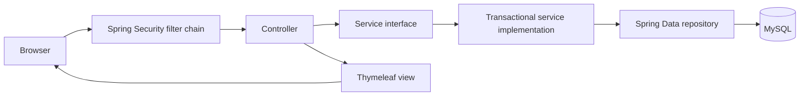
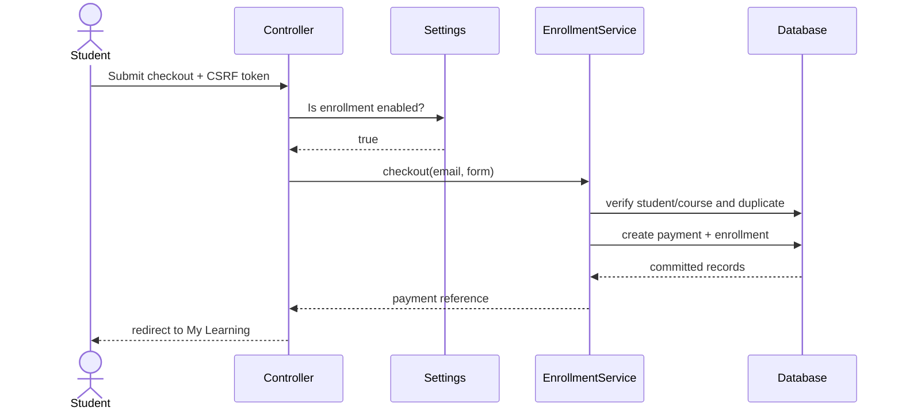

# Architecture

## Request flow

The application follows a conventional layered MVC design:

- `controller`: HTTP routes, form binding, validation results, redirects, and view models.
- `dto`: web-facing form objects. Passwords and other workflow data are not bound directly onto persistent entities.
- `service`: business operations and transaction boundaries.
- `repository`: typed persistence access through Spring Data JPA.
- `entity`: the persistent domain model and relationships.
- `security`: authentication lookup, authorities, login success routing, and URL authorization.
- `templates`: Thymeleaf pages and shared fragments.

## Domain modules

| Module | Responsibility |
|---|---|
| Identity | Admin and student credentials, roles, active state, profiles, password changes |
| Catalog | Course creation, editing, visibility, pricing, level, and status |
| Enrollment | One student/course enrollment, lifecycle status, learning progress |
| Payment | Simulated payment record linked one-to-one with an enrollment |
| CRM | Public inquiries, admin status handling, student feedback, admin responses |
| Operations | Employee records, dashboard metrics, runtime application settings |

## Important design choices

- Constructor injection makes dependencies explicit and testable.
- Controllers depend on services, not repositories, so persistence details do not leak into HTTP code.
- `@Transactional` is placed on service methods where multiple writes must succeed or fail together. Checkout is the clearest example: payment and enrollment are committed as one unit.
- Soft deactivation preserves historical relationships while removing records from active workflows.
- DTO validation rejects malformed input before business logic runs.
- `spring.jpa.open-in-view=false` prevents database access from leaking into template rendering.
- The test profile replaces MySQL with an in-memory H2 database and creates a clean schema per test run.

## Checkout sequence

This is a simulated payment flow for a portfolio project. Integrating a real gateway would add a provider API, signed webhooks, idempotency keys, and server-side verification before marking payment complete.
