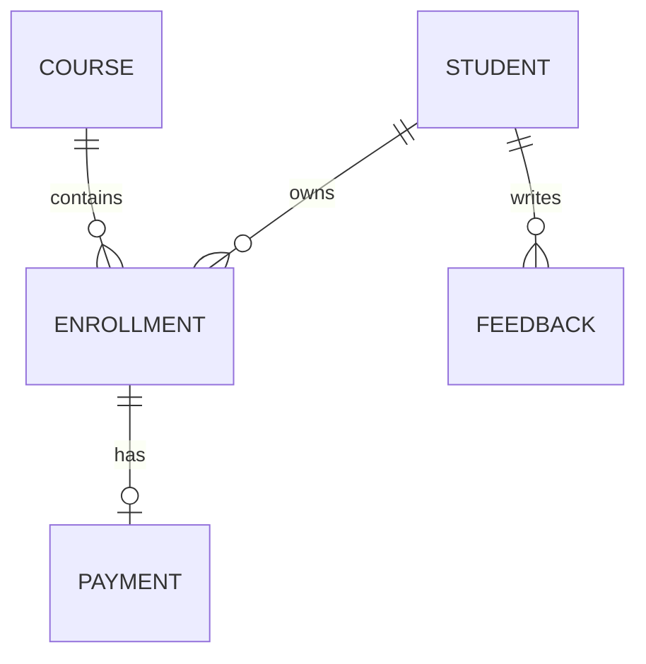

# Database model

## Relationships

`ADMIN`, `EMPLOYEE`, `INQUIRY`, and `APP_SETTING` are independent operational records.

## Core invariants

- Admin and student emails are unique within their tables; registration also rejects an email already used by either role.
- A database unique constraint prevents more than one enrollment for the same student and course.
- Enrollment progress is constrained by service logic to 0–100.
- Money is represented with `BigDecimal`, not floating point.
- Payment references are unique and generated server-side.
- Timestamps are assigned automatically during entity lifecycle callbacks.
- Deactivation is preferred over physical deletion for students, courses, and employees.

## Schema management

Local development uses `spring.jpa.hibernate.ddl-auto=update` so the completed model can be introduced into the existing project database without dropping the user's data. Automated tests use `create-drop` against an isolated H2 database.

For production, convert the resulting schema into a reviewed baseline migration, introduce future changes as immutable versioned migrations, and change runtime DDL mode to `validate`. That transition is safer than applying an unverified baseline automatically to an unknown pre-existing database.

## Main tables

| Entity | Purpose |
|---|---|
| `admins` | Administrator identity and credentials |
| `students` | Student identity, profile, batch/course label, status |
| `courses` | Catalog data, level, price, duration, status |
| `enrollments` | Student/course association, status, progress, timestamps |
| `payments` | Simulated transaction amount, method, status, reference |
| `employees` | Staff records and employment status |
| `feedback` | Student rating/comment and admin response |
| `inquiries` | Public lead/contact request and handling status |
| `app_settings` | Allow-listed key/value application settings |
